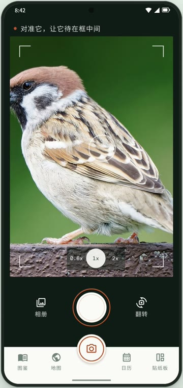
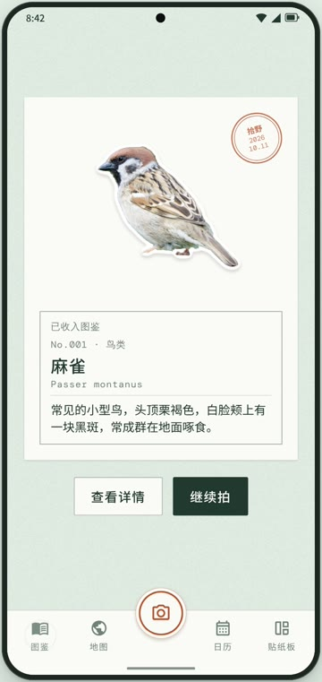
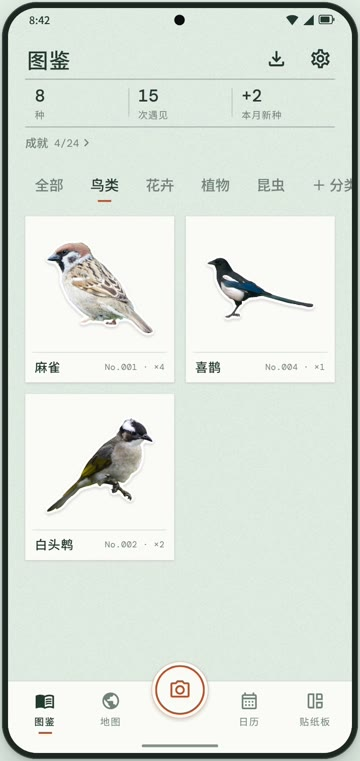
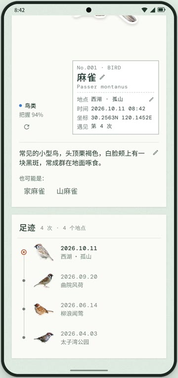
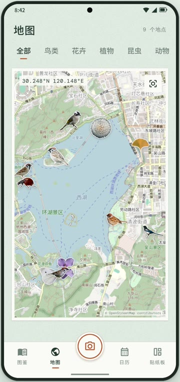
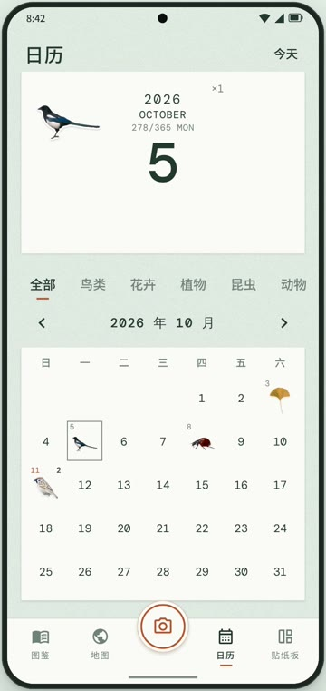
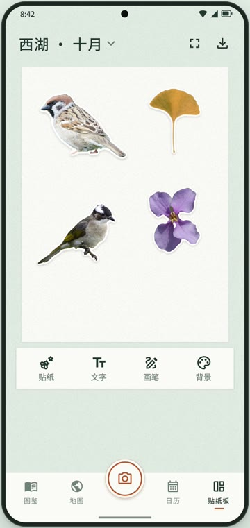
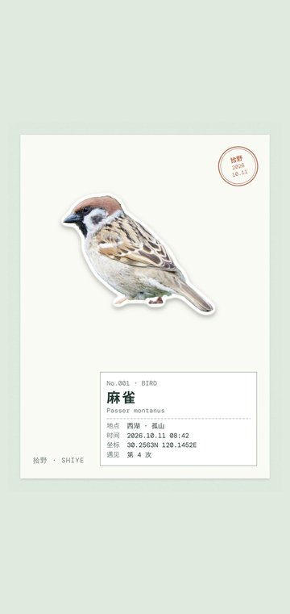

<p align="center">
  
</p>

<h1 align="center">拾野</h1>

<p align="center">
  拍下路上遇见的鸟、花、草木和小动物，拾野会把它抠成一张贴纸，认出它叫什么，收进你自己的图鉴。
</p>

<p align="center">
  <a href="https://github.com/Wenston-dev/nature-collect/releases/latest"></a>
  
  <a href="LICENSE"></a>
</p>

<p align="center">
  中文 · <a href="README.en.md">English</a>
</p>

<p align="center">
  
  
  
  
</p>
<p align="center">
  
  
  
  
</p>

<p align="center">
  <a href="https://github.com/Wenston-dev/nature-collect/raw/main/promo/out/shiye_promo.mp4">看宣传片（45 秒）</a>
</p>

安卓 App，免费、开源，不依赖 Google 服务。

## 下载

- **最新版**：[Releases 页面](https://github.com/Wenston-dev/nature-collect/releases/latest)，下载其中的 `shiye-vX.Y.Z.apk`
- **v1.0.0**：[shiye-v1.0.0.apk](https://github.com/Wenston-dev/nature-collect/releases/download/v1.0.0/shiye-v1.0.0.apk)

把 APK 传到手机上打开安装，第一次装需要允许「安装未知来源应用」。

- 需要 Android 8.0 及以上，64 位 ARM 手机（近几年的手机基本都是）。
- 新版本直接覆盖安装，数据会保留。

## 功能

- **拍照抠图**：拍照或从相册选图，自动找出画面主体，做成白边贴纸。没抠对可以圈选、点选，或用橡皮擦修边，也可以整张贴上。
- **物种识别**：保存后把贴纸发给 AI，得到中文名、英文名或学名、分类和一句简介。没网或没配置时先排队，之后自动补上。认错了可以从备选名里挑，或者手动改。
- **图鉴**：同一物种归在一起，显示遇见次数和初遇日期，可按分类筛选。分类可以自己增删改，AI 识别时会从中挑选。图鉴能导出成一张长图。
- **物种时间线**：每个物种的历次遇见按时间排开，附带去过的地点。
- **地图**：贴纸钉在拍摄地点上。底图可选高德（国内）或 OpenStreetMap（国外）。
- **日历**：每天的格子里放着那天的收集。
- **贴纸板**：多个画板，贴纸可以拖动、缩放、旋转，能加文字、手绘、换背景，导出到相册。
- **分享卡**：把一次收集做成标本卡片的样子，保存或分享。
- **成就**：按自然分类累计物种数，到一定数量解锁。
- **其他**：中英文切换，备份导出与导入（换手机用）。

## 配置 AI 识别

识别走 OpenAI 兼容的 Chat Completions 接口，默认用 DeepSeek，API Key 需要自己申请。

1. 在 [DeepSeek 开放平台](https://platform.deepseek.com/api_keys) 注册，充值少量余额，创建一个 API Key。
2. 第一次打开 App 时把 Key 粘贴进去，或之后在「设置 → 物种识别」里填。

想换别家，在「设置 → 物种识别」里改 Base URL 和模型名，例如 `https://api.openai.com/v1`。模型需要支持图片输入。

Key 加密保存在手机上。识别时只上传抠好的贴纸，不上传原图；抠图在手机本地完成。

## 从源码构建

需要 JDK 17 和 Android SDK。用 Android Studio 打开仓库根目录，或者：

```bash
./gradlew assembleDebug
```

APK 在 `app/build/outputs/apk/debug/`。

## 发布新版本

1. 改 `app/build.gradle.kts` 里的 `versionCode`（加 1）和 `versionName`。
2. 推送同名 tag：

   ```bash
   git tag v1.0.1
   git push origin v1.0.1
   ```

GitHub Actions 会编译 APK，在 Releases 页面建好对应版本并附上安装包。tag 和 `versionName` 对不上时构建会直接失败。

不方便推 tag 时，也可以在 Actions 页面手动运行 Android build 并勾选 release，会按 `versionName` 自动打 tag 并发布。

### 签名密钥

安卓只允许用同一把密钥签名的新版本覆盖旧版本。CI 从仓库 Secret `SIGNING_KEYSTORE_BASE64`（keystore 文件的 base64 文本）读取签名密钥。没有这个 Secret 时退回到 Actions 缓存里的密钥，缓存 7 天没用会被清掉，之后的安装包就无法覆盖安装，所以发布前请先设好 Secret。Fork 出去自己发布的话，请换成你自己的密钥。

## 技术栈

| 环节 | 方案 |
| --- | --- |
| 界面 | Kotlin + Jetpack Compose + CameraX |
| 抠图 | [EdgeTAM](https://github.com/facebookresearch/EdgeTAM) + [U²-Net](https://github.com/xuebinqin/U-2-Net)（ONNX Runtime，手机本地运行） |
| 识别 | 任意 OpenAI 兼容接口，默认 DeepSeek |
| 地图 | MapLibre，高德瓦片 / OpenFreeMap；地名来自 Nominatim |
| 存储 | Room + 本地图片文件 |

`app/src/main/assets/sam/` 里的 EdgeTAM 模型由 `tools/export_edgetam_onnx.py` 从官方权重导出，只保留单张图片分割部分，和 PyTorch 原版对比掩码 IoU 约 0.997。`u2netp.onnx` 是 U²-Net 的轻量显著性模型，用来先找到画面主体，再交给 EdgeTAM 精确分割。

`promo/` 是宣传片的源文件，说明见 [promo/README.md](promo/README.md)。上面的截图取自宣传片。

## 开源协议

代码以 [MIT](LICENSE) 协议发布。随附的 EdgeTAM、U²-Net 模型为 Apache-2.0，DM Mono 字体为 SIL Open Font License。宣传片里的照片来自 Wikimedia Commons，作者和授权见 [promo/credits.txt](promo/credits.txt)。
